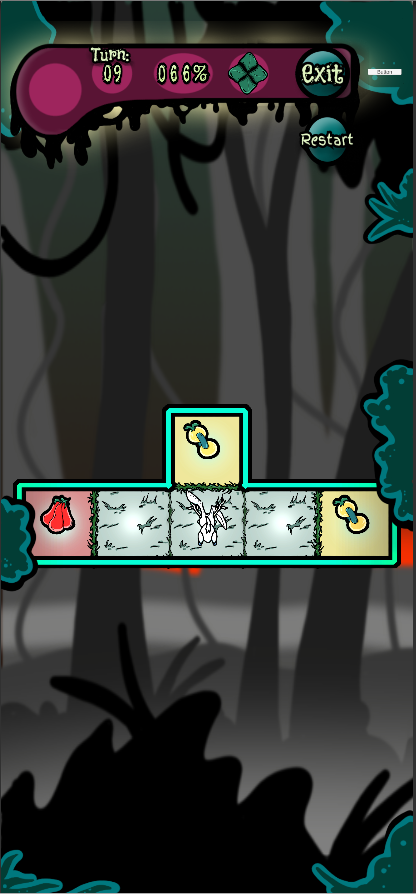
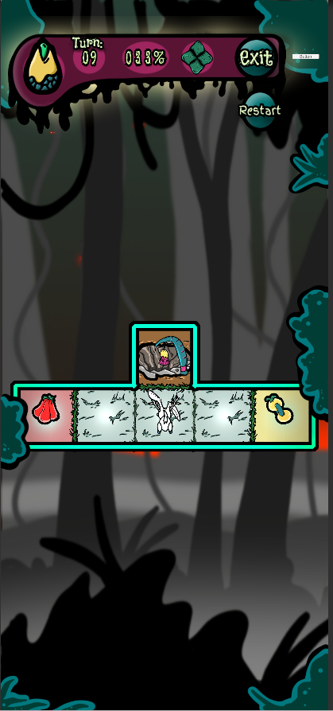

# Harvest or Die LLM Puzzle Agent

An LLM Agent that plays **Harvest or Die**, a turn-based grid puzzle game I built in Unity.

In the game you play as the bunny and your goal is to make all fruit the same color. To do that, you harvest a fruit which gives you a colored seed. 

 

The point of this project is not only to get a language model to play the game, but the measurement apparatus around it. There is a validated simulator, a reproducible eval harness, deterministic baselines, and controlled ablations to isolate *why* the agent fails.

Four different methodologies are compared here.

Random: The bunny makes random legal moves

Greedy: The agent simulates every legal move one step ahead, discards any that would kill it, and picks whichever leaves the board closest to a win by the solver's distance estimate.

LLM, Board Only: OpenAI gpt-5.6-luna sees just the rendered board and status text, so it must work out for itself whether a move is lethal.

LLM + fatal-move annotation: The same prompt plus an explicit list of which legal moves would kill it this turn, computed by the simulator and handed over rather than inferred

---

## Headline result

### Level 3 — all agents, 250 episodes each

| Agent | Win rate | Death | Timeout | Mean turns |
|---|---|---|---|---|
| Random (legal moves only) | 0.0% | 100.0% | 0.0% | 2.2 |
| Greedy (1-step lookahead, exact forward model) | 18.4% | 0.0% | 81.6% | 8.6 |
| LLM, board only | 20.4% | 60.8% | 18.8% | 5.1 |
| **LLM + fatal-move annotation** | **34.0%** | **0.8%** | 65.2% | 8.4 |

`level_3` has a 9-turn limit and no predators, so cornering is 0% throughout.

Without being given an explicit list of deadly moves the LLM agent statistically ties with the greedy agent (20.4% vs 18.4%). This is because the LLM dies 61% of the time while the greedy agent runs out of turns. This confirmed not only be the number of deaths and timeout but the average number of turns the greedy agent takes versus the LLM. 

When the LLM is given an explicit list of deadly moves then the LLM beats Greedy. It wins 34% of the time and only times out 65% of the time. 

### Level 6 — all agents, 2100 episodes each

| Agent | Win rate | Death | Timeout | Mean turns |
|---|---|---|---|---|
| Random | 0.0% | 100.0% | 0.0% | 2.2 |
| Greedy (1-step lookahead) | 13.0%| 0.0% | 87.0% | 11.6 |
| LLM, board only | 28.0% | 66.0% | 6.0% | 6.1 |
| **LLM + fatal annotation** | **50.0%** | **1.0%** | 49.0% | 10.8 |

`level_6` has a 12-turn limit and no predators, so cornering is 0% throughout.

Without being given an explicit list of deadly moves the LLM agent statistically outperforms the greedy agent (28.0% vs 13.0%). Similar to level 3, the greedy agents times out very often.
When the LLM is given an explicit list of deadly moves then the LLM wins 50% significantly beating the LLM alone. 

### Level 14 — the hard level, 28-turn limit with predators

| Agent | n | Win | Death | Cornered | Timeout | Mean turns |
|---|---|---|---|---|---|---|
| Random (legal moves only) | 1000 | 0.0% | 99.4% | 0.6% | 0.0% | 2.9 |
| Greedy (1-step lookahead) | 1000 | 0.0% | **0.0%** | **56.5%** | 43.5% | 17.7 |
| LLM, board only | 30 | 0.0% | 96.7% | 3.3% | 0.0% | 11.7 |
| **LLM + fatal annotation** | 40 | **7.5%** | 10.0% | **32.5%** | 50.0% | 22.3 |

LLM rows pooled across runs; n is small because each episode is up to 28 sequential API calls.

Level 14 introduces enemies slimes so 'Cornered' was included as a final state for an agent. This occurs when the agent is cornered by enemy slimes and there is no where safe for it to go.

Here only the LLM agent with the explicit list of deadly moves wins at all. 

--- 

### What the agent does when it loses

To understand why the LLM agent was timing out the avrage number of 

| outcome | n | seed switches | turns | futile harvests | ≥1 futile |
|---|---|---|---|---|---|
| WIN | 50 | 5.18 | 9.8 | **0.22** | **18%** |
| TIMEOUT | 49 | 4.45 | 12.0 | **1.10** | **76%** |
| DEATH | 1 | 2.00 | 3.0 | 1.00 | 100% |

Per-episode means, level 6, n = 100. `level_6` has a 12-turn limit.

Across 100 episodes on level 6 there were 50 wins, 49 timeouts, and one death. Timeouts correlate strongly with futile harvests. A futile harvest is when the agent harvests a plant whose color matches the seed it is already holding: the region regrows that same color and the seed does not change, so once the holes close the board is exactly as it was. On a level with predators this can be deliberate, since a predator forced onto a hole dies but level 6 has no predators, so it is simply a wasted turn. Winning episodes averaged 0.22 futile harvests and only 18% contained one at all; timeouts averaged 1.10, and 76% contained at least one.

## Fixing the futile harvests didn't help

To fix this the futile harvests issue the LLM was told when a move would be futile, similar to the approach that worked for fatal moves.

**The agent listened.** Futile harvests dropped by roughly a factor of five:

| | annotation off | annotation on |
|---|---|---|
| timeout episodes with ≥1 futile harvest | 68.8% | **23.2%** |
| futile harvests per timeout episode | 1.08 | **0.22 / 0.29** |
| futile harvests per winning episode | 0.27 | **0.03 / 0.05** |

**And it won no more often.**

| condition | n | win rate | 95% CI |
|---|---|---|---|
| annotation off | 400 | 59.2% | [54.4–64.0] |
| annotation on | 500 | 60.2% | [55.8–64.4] |

A difference of +0.9 points, *p* = 0.773. The design had 80% power to detect a 9-point shift, so
this is a resolved null rather than a sample too small to tell.

So the futile harvest was a **symptom of losing, not a cause of it**. 

Reproduce: `python -m scripts.stats compare WIN 20261022-070442-2a58 vs 20261020-063246-27d4 20261016-195501-48f3